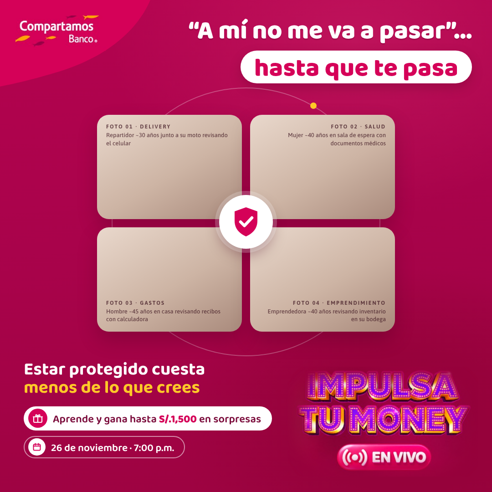

# Compartamos Banco · IMPULSA TU MONEY — "A mí no me va a pasar"

Pieza 1:1 (1080 × 1080) para redes. Concepto: *"A mí no me va a pasar"… hasta que te pasa.*

## Decisiones de dirección de arte

- **Del Qore del BCP tomamos solo la estructura:** un módulo central de fotos con mucho espacio negativo alrededor y un anillo fino como lectura de "respaldo". Colores, tipografía y recursos son de Compartamos: la pestaña magenta de la esquina, las cápsulas blancas y los acentos amarillos.
- **Recorrido de lectura:** titular (arriba a la derecha, cápsula blanca en el remate) → grilla 2×2 de fotos → escudo blanco en la intersección de las cuatro tarjetas → mensaje del seguro → cápsula de sorpresas y fecha → logo IMPULSA TU MONEY abajo a la derecha, como cierre.
- **El escudo** se ve plano (magenta con check blanco sobre un círculo blanco), sin brillos ni partículas. Va en la unión de las cuatro escenas, pero no tapa ninguna cara.
- **No se sugiere cobertura automática:** el escudo une la composición y no se coloca sobre cada foto. Ninguna tarjeta lleva un check propio.
- **Fondo:** degradado magenta muy sutil. Detrás del logo IMPULSA TU MONEY se oscurece para igualar el fondo original del logo.

## Pendientes antes de publicar

1. **Fotografía.** Las tarjetas son *placeholders*. Guarda las 4 fotos en `fotos/` (`01-delivery.jpg`, `02-salud.jpg`, `03-gastos.jpg`, `04-emprendimiento.jpg`, 4:3, mínimo 960 × 690 px), agrega `class="final"` al `<body>` para ocultar las etiquetas y vuelve a renderizar.
2. **Logos.** No llegaron como archivos sueltos, así que `logo_compartamos.png` y `logo_itm.png` son recortes **sin alterar** de las piezas oficiales de referencia (al logo ITM solo se le suavizó el borde del recorte). Reemplázalos por los archivos originales (PNG con transparencia) con el mismo nombre.
3. **Tipografía.** Bree es una fuente comercial que no está en este entorno. La maqueta usa **Baloo 2** (titulares) y **Asap** (etiquetas). Con la licencia de Bree, cambia `font-family` en `pieza.html` y ajusta tamaños si hace falta.

Render: `NODE_PATH=$(npm root -g) node render.js "$PWD/pieza.html" salida.png` (requiere Playwright).

## Brief fotográfico (las 4 escenas)

Tratamiento común: fotografía comercial natural, luz de día suave y lateral, tonos cálidos neutros, profundidad de campo media (fondo legible pero desenfocado), lente de 50 mm a la altura de los ojos, plano medio, personas peruanas reales con piel con textura. Las expresiones son serenas y pensativas, nunca angustiadas. El sujeto va hacia el borde exterior de cada tarjeta y deja libre la esquina interior, donde va el escudo.

| # | Escena | Indicaciones |
|---|---|---|
| 01 | Delivery | Repartidor de ~30 años junto a su moto estacionada en una calle de Lima (Surquillo o Lince), con casaca y mochila térmica genéricas, sin marcas. Mira una notificación en el celular con el ceño apenas fruncido. Sujeto a la izquierda del cuadro. |
| 02 | Salud | Mujer de ~40 años sentada en la sala de espera de una clínica moderna y luminosa, con un sobre o documentos médicos en el regazo. Mirada baja, tranquila. Sujeto a la derecha del cuadro. |
| 03 | Gastos | Hombre de ~45 años en la mesa del comedor de su casa, con recibos y una calculadora, concentrado y sereno, con la mano sobre los papeles. Sujeto a la izquierda del cuadro. |
| 04 | Emprendimiento | Emprendedora de ~40 años en su bodega moderna y ordenada, revisando estantes con una libreta. Expresión responsable y natural. Sujeto a la derecha del cuadro. |

### Prompt base para generación (si se usa IA en lugar de sesión de fotos)

> Fotografía comercial hiperrealista, formato 4:3. [ESCENA]. Persona peruana mestiza de rasgos andinos o costeños, piel con textura natural y poros visibles, manos con cinco dedos bien proporcionados. Luz de día suave lateral, tonos cálidos neutros, ligera calidez magenta en las sombras, 50 mm f/2.8, plano medio a la altura de los ojos, fondo desenfocado y ordenado. Expresión serena y pensativa, nada dramática. Sin texto, sin logos, sin marcas, sin efectos de luz, sin destellos.

Genera las cuatro con el mismo modelo y la misma *seed* y usa la primera como referencia de estilo para las otras tres, para que el tratamiento sea uniforme.
